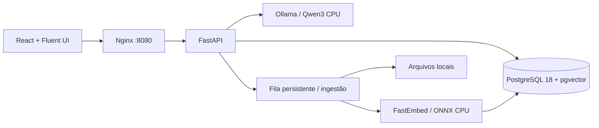

# Mini RAG para WSL

Converse em português com os seus documentos, inteiramente na sua máquina. Aplicação para **Ubuntu 24.04 ou superior no WSL2**, com PostgreSQL **18.6**, pgvector **0.8.7**, chat com streaming e uma biblioteca para upload, seleção, acompanhamento e exclusão de arquivos.

O modelo recebe os trechos recuperados a cada pergunta. A ingestão **não retreina os pesos** do modelo. Não há serviço de IA pago, chave de API ou envio de documentos para uma nuvem.

## Início rápido

Pré-requisitos: Windows com WSL2, Ubuntu 24.04+, Git para clonar o projeto e acesso a `sudo` para instalar pacotes. O instalador abaixo prepara Docker, Compose e Buildx. Use **uma** instalação Docker: Engine dentro do Ubuntu ou integração WSL do Docker Desktop/Rancher Desktop. Ao terminar a preparação, o comando `docker info` precisa funcionar no Ubuntu.

No terminal Ubuntu:

```bash
mkdir -p ~/projetos
cd ~/projetos
git clone https://github.com/jeanbezerra/mini-rag-wsl.git
cd mini-rag-wsl
bash scripts/install-deps.sh
bash scripts/bootstrap.sh
```

Abra **http://localhost:8080** no Windows. O script cria um `.env` com senhas aleatórias e constrói os serviços. O primeiro início baixa Qwen3 (~1,4 GB) e os embeddings; aguarde o indicador de modelo disponível. As execuções seguintes usam os volumes locais.

```bash
docker compose logs -f model-init api   # Ctrl+C apenas encerra a exibição
bash scripts/doctor.sh                 # versões reais, checksums, roles e saúde
docker compose down                   # para a aplicação, preservando os dados
docker compose up -d                  # inicia novamente
```

O [instalador de dependências](scripts/install-deps.sh) instala os pacotes básicos ausentes (incluindo OpenSSL, curl, certificados e Git). Se já houver Docker, Compose e Buildx acessíveis, ele os reutiliza. Caso contrário, instala Docker Engine pelo [repositório oficial para Ubuntu](https://docs.docker.com/engine/install/ubuntu/), habilita o serviço e configura o grupo `docker` para seu usuário. Execute como seu usuário habitual; os comandos de instalação usam `sudo` quando necessário.

Após entrar no grupo `docker`, sua sessão pode precisar ser atualizada. Se o instalador indicar essa situação, execute `newgrp docker`, confira `docker info` e só então rode o bootstrap. Esse grupo concede acesso administrativo ao daemon, conforme a [documentação Docker](https://docs.docker.com/engine/install/linux-postinstall/). O instalador retorna código `2` quando depende de uma ação de sessão ou reinício do WSL.

Para escolher explicitamente o runtime:

```bash
bash scripts/install-deps.sh --runtime engine   # Engine nativo no Ubuntu
bash scripts/install-deps.sh --runtime desktop  # Docker Desktop/Rancher do Windows
```

No modo `desktop`, inicie o aplicativo no Windows e habilite a distribuição na [integração WSL](https://docs.docker.com/desktop/features/wsl/). O instalador verifica CLI, Compose, Buildx e acesso ao daemon. O modo padrão `auto` reconhece integrações existentes e não instala um segundo Engine sobre elas. Pacotes conflitantes são informados para revisão, sem remoção automática.

Docker Engine nativo exige systemd ativo. Se necessário, o instalador mostra como habilitá-lo em `/etc/wsl.conf`, preservando outras configurações, e reiniciar o WSL conforme as [instruções da Microsoft](https://learn.microsoft.com/windows/wsl/systemd). Depois do reinício, execute o instalador novamente. Ele não reinicia o Windows/WSL nem inicia a aplicação automaticamente.

Para instalar o Ubuntu pelo PowerShell do Windows: `wsl --install -d Ubuntu-24.04`. A primeira configuração pode exigir reinício. Não é necessário instalar Python, Node, PostgreSQL ou Ollama no host para executar via Compose.

Clone no sistema de arquivos Linux (`~/projetos`), para melhor I/O que `/mnt/c`. Se já clonou no Windows, você pode executar o projeto pelo caminho `/mnt/c/...`; o script apenas mostra uma recomendação.

## Preparar um WSL que já tem Kubernetes

Use [scripts/cleanup-wsl.sh](scripts/cleanup-wsl.sh) para migrar um Ubuntu WSL com Kubernetes instalado por APT/kubeadm para Docker CE. Primeiro confira o plano, sem alterar o sistema:

```bash
bash scripts/cleanup-wsl.sh
```

O script reconhece pacotes Kubernetes marcados como `hold` e seleciona somente os pacotes Kubernetes e os conflitos Docker conhecidos, incluindo `containerd`, `runc` e `docker.io`. Simula a resolução APT e recusa remoções adicionais fora da lista. Não usa `autoremove`.

Se houver um nó Kubernetes configurado, sua remoção exige a opção abaixo. Ela autoriza o reset local, interrompe pods e pode destruir dados locais; salve o que precisa antes. Você pode visualizar esse plano completo sem aplicá-lo:

```bash
bash scripts/cleanup-wsl.sh --delete-cluster-data
```

Para aplicar a remoção do nó e dos pacotes selecionados:

```bash
bash scripts/cleanup-wsl.sh --apply --delete-cluster-data
```

Se não existir nó configurado, `bash scripts/cleanup-wsl.sh --apply` basta. O reset usa o socket CRI Unix local do containerd e ignora a fase que remove membros etcd, conforme as opções do [kubeadm reset](https://kubernetes.io/docs/reference/setup-tools/kubeadm/kubeadm-reset/). O script não executa `kubectl`, limpeza global de iptables, remoção de volumes Docker nem exclusão de distribuições WSL. Mantém o kubeconfig do usuário e não purga diretórios CNI/etcd indiscriminadamente.

K3s, RKE2, MicroK8s e k0s são detectados e exigem seus próprios procedimentos de desinstalação; o script interrompe a aplicação para essas instalações. Clusters kind/minikube e suas VMs/containers não são gerenciados por este script.

Se a CLI Docker vier de **Rancher Desktop ou Docker Desktop**, desative a integração desta distribuição nas configurações do aplicativo Windows antes de instalar o Engine nativo. O Kubernetes gerenciado por esse aplicativo também deve ser desativado nele. O script mostra a integração detectada e não altera aplicativos Windows ou o PATH automaticamente.

Depois da limpeza e do ajuste da integração externa, execute:

```bash
bash scripts/install-deps.sh --runtime engine
# Siga eventuais instruções de newgrp docker e então:
bash scripts/bootstrap.sh
```

## Como usar

1. Na biblioteca, envie um **PDF com texto, TXT, Markdown ou DOCX**. Há um documento fictício em [examples/boas-vindas.md](examples/boas-vindas.md).
2. Aguarde o estado **Pronto**. A fila fica no PostgreSQL e retoma trabalhos interrompidos após reinício.
3. Pergunte, por exemplo: “Quem é a responsável pelo Projeto Aurora e qual é o orçamento?”
4. Abra as fontes da resposta para conferir o trecho e, em PDFs, a página. Você pode restringir a busca aos documentos selecionados.
5. Use uma nova conversa para mudar de assunto. Conversas ficam no armazenamento local do navegador; documentos e vetores ficam no servidor local.

Uploads são limitados a 25 MB por arquivo, 200 documentos, 500 páginas por PDF e 2.000 trechos por documento por padrão. Esses limites podem ser ajustados na área **Configurações**. PDFs digitalizados sem camada de texto precisam passar por OCR antes do upload. Arquivos protegidos por senha ou sem texto utilizável são apresentados como erro. É possível tentar a ingestão novamente pela interface.

## Configurações compartilhadas

Abra **Configurações** no cabeçalho da aplicação. Todas as pessoas que acessam o Mini RAG podem consultar e alterar os ajustes; eles valem globalmente para a aplicação, sem login ou perfis de acesso.

| Objetivo | Ajustes disponíveis |
| --- | --- |
| Modelo e respostas | Modelo local, criatividade (temperatura), top-p, penalidade de repetição e limite da resposta |
| Velocidade e memória | Threads de CPU, janela de contexto, lote de geração, permanência do modelo na RAM e tempo máximo de resposta |
| Busca nos documentos | Quantidade de trechos recuperados e similaridade mínima |
| Ingestão e limites | Tamanho/sobreposição dos fragmentos, lote de embeddings, tamanho dos uploads, quantidade de documentos, páginas de PDF, texto extraído, DOCX descompactado e trechos por documento |

Cada campo explica o efeito do ajuste e seus limites. **Salvar alterações** valida e persiste a configuração no PostgreSQL. **Restaurar padrões** preenche o formulário com os valores iniciais do ambiente; use Salvar para aplicá-los. Você pode desfazer a edição antes de salvar.

Os ajustes de geração e busca passam a valer nas próximas perguntas. Limites e fragmentação afetam novas ingestões e novas tentativas de documentos com erro; documentos já indexados mantêm seus trechos. O modelo de embeddings permanece fixo para preservar a compatibilidade dos vetores existentes.

A configuração salva sobrevive ao reinício da aplicação e prevalece sobre os valores iniciais do `.env`. As credenciais do banco e os endereços internos dos serviços continuam fora dessa tela. Se houver resposta ou ingestão em andamento, aguarde a conclusão para salvar. Se outra pessoa salvar uma configuração enquanto você edita, a aplicação informa o conflito e mantém sua edição para você decidir se deseja recarregar.

A seleção do modelo usa os modelos já baixados no Ollama local. Para disponibilizar outro modelo, baixe-o pelo terminal e atualize a lista na tela de configurações. O endpoint de configurações não dispara downloads.

## Modelos e otimização de CPU

| Componente | Padrão | Motivo |
| --- | --- | --- |
| Geração | `qwen3:1.7b-q4_K_M` | Modelo pequeno, quantização Q4_K_M, português e licença Apache 2.0 |
| Embeddings | `sentence-transformers/paraphrase-multilingual-MiniLM-L12-v2` | ONNX quantizado, CPU, 384 dimensões, multilíngue, Apache 2.0 |
| Inferência | Ollama `0.40.8` | Runtime local, streaming e cache do modelo |
| Recuperação | pgvector + full-text em português | Similaridade semântica e termos exatos combinados por reciprocal rank fusion |

O backend força `num_gpu=0` e `think=false`, mantém um único fluxo de geração, limita contexto/resposta e reutiliza o modelo em memória. O Compose não passa dispositivos GPU ao Ollama. Embeddings usam ONNX Runtime CPU, lotes pequenos e threads limitadas. Os trechos respeitam o tokenizador real e o limite curto do modelo de embeddings, evitando indexar somente o começo de blocos longos.

Como ponto de partida, reserve **8 GB de RAM para o WSL e 4 CPUs**; o consumo e a velocidade dependem do hardware e do tamanho dos documentos. Essa é uma orientação inicial, não um benchmark. Ajuste as threads na área **Configurações**; mais threads nem sempre melhoram a latência. `CPU_THREADS` no `.env` define o valor inicial. Ingestão e chat compartilham o orçamento de CPU.

Para reduzir memória e latência, com perda de qualidade nas respostas:

```bash
docker compose exec ollama ollama pull qwen3:0.6b-q4_K_M
```

Depois, abra **Configurações → Modelo e respostas**, atualize a lista de modelos, selecione `qwen3:0.6b-q4_K_M` e salve. `OLLAMA_MODEL` no `.env` define o modelo inicial e o download do serviço `model-init`; uma configuração já salva no banco prevalece sobre essa variável. O modelo anterior continua no cache e pode ser removido manualmente com `docker compose exec ollama ollama rm NOME_DO_MODELO` quando não estiver em uso.

Se necessário, configure a memória global do WSL em `%UserProfile%\.wslconfig` no Windows, conforme os [recursos oficiais do WSL](https://learn.microsoft.com/windows/wsl/wsl-config). Depois de salvar, `wsl --shutdown` aplica a mudança e encerra **todas** as distribuições WSL abertas.

```ini
[wsl2]
memory=8GB
processors=4
swap=4GB
```

## Arquitetura e persistência



- `frontend/`: React, TypeScript, Vite, Fluent UI v9 e Nginx; interface e APIs compartilham a mesma origem.
- `backend/`: FastAPI, extração de documentos, fila, embeddings e recuperação híbrida. Um único worker Uvicorn mantém o orçamento de memória e a serialização da geração.
- `database/`: PostgreSQL oficial 18.6 com pgvector compilado em uma etapa separada. `OPTFLAGS=""` evita exigir instruções específicas da CPU da máquina que construiu a imagem.
- `migrate`: job único, com role `rag_migrator`, aplica o schema versionado antes da API.
- `model-init`: baixa o modelo para o Ollama sem bloquear a disponibilidade da interface.

| Volume Compose | Conteúdo |
| --- | --- |
| `postgres_data` | Banco, textos, metadados, fila e vetores; montado em `/var/lib/postgresql`, conforme layout do PostgreSQL 18 |
| `app_data` | Arquivos enviados e cache dos embeddings em `/data` |
| `ollama_models` | Modelos de geração |

**Não use `docker compose down -v` para parar a aplicação:** essa opção remove os volumes e seus dados. Preserve o `.env`; mudar apenas as senhas nele não altera roles de um banco já inicializado. Scripts em `database/init` executam somente no primeiro início de um volume vazio. Atualizações de schema usam o job `migrate`.

As configurações globais também ficam no PostgreSQL e entram no backup do banco. Para atualizar uma instalação existente com esta versão, execute `docker compose up --build -d`; o job de migração cria a tabela de configurações antes da API iniciar, preservando documentos e vetores.

## Segurança e limites de uso

A única porta publicada é `127.0.0.1:8080`; PostgreSQL e Ollama ficam na rede interna do Compose. A API usa `rag_app`, sem superuser ou DDL; a role de migração tem credenciais separadas e não é disponibilizada à API. Consultas são parametrizadas e a API roda como usuário sem privilégios. O banco mantém checksums, WAL e durabilidade padrão.

Esta é uma aplicação **de acesso compartilhado, sem autenticação ou contas de usuário**. Quem acessar a interface pode usar a biblioteca, conversar e alterar as configurações globais. A publicação padrão permanece em localhost; o alcance do acesso depende da configuração de rede do host. Documentos são dados não confiáveis no prompt; um modelo pequeno ainda pode errar ou seguir instruções contidas nos documentos. Confira as fontes.

O primeiro build e os downloads de modelos precisam de internet. Depois que as imagens e os dois modelos estiverem no cache, as respostas são processadas localmente. Os documentos e o histórico do chat não são enviados para APIs de IA externas.

## Desenvolvimento e validação

Use Python **3.12**, [uv](https://docs.astral.sh/uv/) e Node **22+** para desenvolvimento fora dos containers. O projeto inclui locks de dependências.

```bash
# Backend
cd backend
uv sync --frozen
uv run ruff check .
uv run pytest -m 'not integration'

# Frontend (outro terminal)
cd frontend
npm ci
npm test
npm run build
```

Para integração, use um **banco descartável** PostgreSQL 18 com pgvector. O override de testes publica o banco somente para localhost, porta 55432:

```bash
# Na raiz, após gerar .env pelo bootstrap
docker compose -p mini-rag-test -f compose.yaml -f compose.test.yaml up --build -d --wait db
```

No terminal de testes, defina `TEST_DATABASE_URL` para a role `rag_app` e `TEST_MIGRATION_DATABASE_URL` para `rag_migrator`, usando as senhas do seu `.env`, host `localhost`, porta `55432`, banco `mini_rag`. Depois:

```bash
cd backend
uv run pytest -m integration
```

Esses testes verificam o banco real e não precisam baixar o LLM. O workflow [CI](.github/workflows/ci.yml) executa builds, testes e integração num banco isolado. Para testar a geração real, envie o arquivo de exemplo e pergunte seus dados; compare resposta e fontes. Não há taxa de tokens/s garantida sem benchmark na sua CPU.

Os testes dos scripts podem ser executados com `bash scripts/tests/test-install-deps.sh` e `bash scripts/tests/test-cleanup-wsl.sh` em Linux com Bubblewrap (`bwrap`) e suporte a namespaces de usuário. Eles simulam os comandos administrativos, bloqueiam a rede e mantêm os arquivos do host somente leitura. Bubblewrap e ShellCheck são ferramentas de desenvolvimento opcionais; não são necessários para executar o instalador ou a aplicação.

O teste de limpeza também usa Python 3 para criar um socket Unix fictício; isso não adiciona uma dependência ao script de limpeza em si.

Consulte [docs/validation.md](docs/validation.md) para as evidências já executadas e as verificações ainda pendentes nesta entrega, incluindo a execução completa do Compose e a geração real pelo Ollama.

O proxy Vite usa `http://localhost:8000` para `/api`. Para desenvolvimento completo, disponibilize o banco de teste, execute `DATABASE_URL=... uv run python -m rag.migrate` com a role migrator e então `DATABASE_URL=... OLLAMA_BASE_URL=http://localhost:11434 DATA_DIR=./data uv run uvicorn rag.app:app --reload` com a role app. Configure seu Ollama local e baixe o modelo. O fluxo normal via Compose dispensa essa configuração manual.

## Backup

```bash
bash scripts/backup.sh
```

O script pausa a API, exporta o banco em formato custom e arquiva os documentos/cache; reativa a API ao terminar, inclusive em caso de falha. Os arquivos ficam em `backups/` com SHA-256. Guarde separadamente o `.env`. Os pesos Ollama podem ser baixados novamente.

Para um ensaio de recuperação, inicialize um **outro projeto Compose com volumes novos**, pare sua API, restaure `database.dump` com `pg_restore` no banco novo e extraia `app-data.tar.gz` no novo volume `app_data`, preservando o usuário 10001. Use `--clean --if-exists` somente no banco novo de teste, com as roles de bootstrap já criadas. Um backup só deve ser considerado recuperável depois desse ensaio. Nunca restaure sobre o único ambiente que contém seus dados.

## Referências das escolhas

- [Qwen3 1.7B Q4_K_M no catálogo oficial](https://ollama.com/library/qwen3:1.7b-q4_K_M) e [licença do modelo](https://huggingface.co/Qwen/Qwen3-1.7B).
- [FastEmbed e modelos suportados](https://qdrant.tech/documentation/embeddings/fastembed/) e [modelo multilíngue](https://huggingface.co/sentence-transformers/paraphrase-multilingual-MiniLM-L12-v2).
- [API de chat Ollama](https://docs.ollama.com/api/chat) e [execução em CPU com Docker](https://docs.ollama.com/docker).
- [PostgreSQL 18.6](https://www.postgresql.org/docs/release/18.6/), [layout da imagem oficial](https://hub.docker.com/_/postgres) e [pgvector](https://github.com/pgvector/pgvector).
